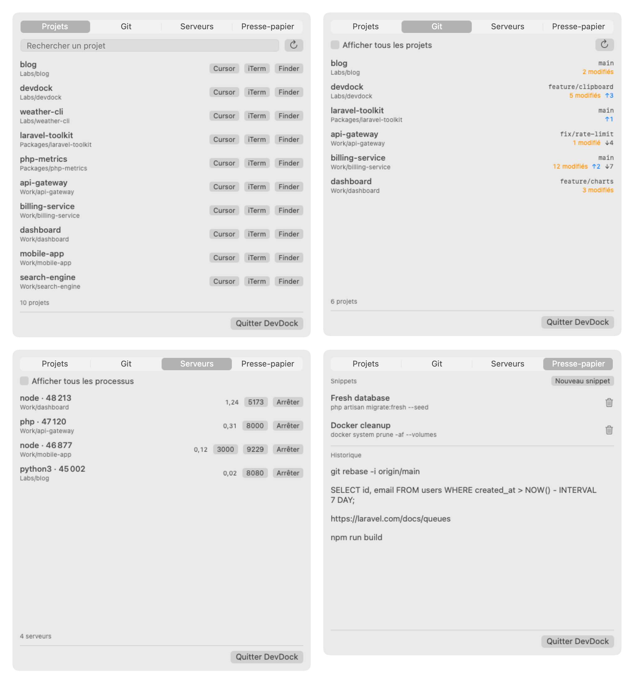

# devdock

A tiny macOS menu bar app for the developer's daily routine, built around the git projects found in `~/Sites`.



- **Projects**: search your repositories and open one in Cursor, iTerm or Finder.
- **Git**: see which projects have uncommitted changes or unpushed commits, with their branch and how far behind they are.
- **Servers**: list the processes listening on a TCP port, linked to the project they run from, with their CPU usage in cores. Open `localhost:port` or stop the process in one click.
- **Clipboard**: the last 30 copied texts (in memory only, password manager copies are ignored) and saved snippets.

Git statuses are read locally (`git status`, no fetch), servers come from `lsof`, and snippets are stored in `~/Library/Application Support/devdock/snippets.json`.

## Requirements

macOS 13+ and Swift (the Xcode Command Line Tools are enough).

## Build and run

```bash
./build.sh
open DevDock.app
```
